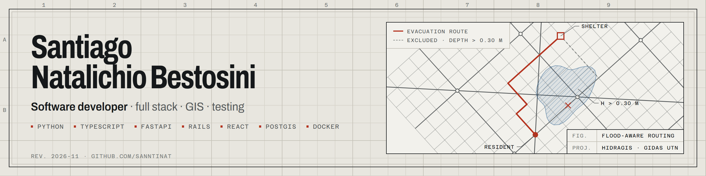

<picture>
  <source media="(prefers-color-scheme: dark)" srcset="banner/github-dark.png">
  
</picture>

**Software developer** and final-year **Information Systems Engineering** student at UTN La Plata, Argentina.
I build applications end to end (data model, API and interface) and I test what I ship.

📍 Quilmes, Argentina · 🎓 Graduating 2027 · 🗣️ Spanish (native), English (B2, Cambridge FCE)

## Right now

- **Software Engineering Intern at GIDAS**, UTN La Plata's research lab: building **HIDRAGIS**, a GIS flood early-warning system for La Plata.
- **OnStock**, my final-year capstone: inventory, orders and shipping for online stores.

## Featured work

### 🌊 HIDRAGIS · GIS flood early-warning system
Private repository · GIDAS research lab · team of 3

`Python` `FastAPI` `PostgreSQL` `PostGIS` `pgRouting` `GeoServer` `Leaflet` `pytest` `Playwright` `Docker`

- **Flood-aware evacuation routing** on the OpenStreetMap street graph with pgRouting: segments flooded deeper than 0.3 m leave the route in real time, with hysteresis so a published route doesn't flap.
- **Terrain to risk zones:** hydrological correction of elevation models, watershed delineation and HAND flood-susceptibility zoning (pysheds, rasterio), with reproducible, hash-tracked runs.
- **Maps as standard services:** cartography API in FastAPI, OGC WMS/WFS layers with GeoServer and a versioned open-data portal.
- 26 user stories across 15 reviewed pull requests, with **680+ automated tests** (unit, integration, system and E2E) on GitHub Actions.

### 📦 [OnStock](https://github.com/proyectoFinalFRLP) · inventory, orders and shipping platform
Final-year capstone · team of 4 · [API](https://github.com/proyectoFinalFRLP/proyecto-api) · [Web](https://github.com/proyectoFinalFRLP/proyecto-web)

`Ruby on Rails 8` `PostgreSQL` `React 19` `TypeScript` `MUI` `TanStack Query` `RSpec`

- Built the **orders and shipments domain** of a multi-tenant platform that syncs stock with Shopify, Tiendanube and Mercado Libre.
- **Courier tracking without webhooks** (OCA, Andreani) through background polling jobs, plus quoting and dispatch of manual orders.
- 18 merged pull requests across API and web, **430+ RSpec examples**, 55+ pull request reviews.

### 🛡️ [Sistema Inmune](https://github.com/Sanntinat/goys-tp4-integrador) · a network that heals and defends itself
Network Operations and Security course · team of 4 · built for UTN's Networking Fair

`MikroTik RouterOS` `GNS3` `BGP` `OSPF` `VRRP` `Prometheus` `Grafana` `Ansible` `Docker`

- A 7-router enterprise network that recovers on its own from link, router and ISP failures (VRRP, OSPF and eBGP multi-homing), now with a **real-time Grafana dashboard and alerts**.
- **I built the edge defense:** it detects a port scan and blocks the attacker **0.08–2.72 s** after it starts, while BGP, OSPF and monitoring stay up.
- I also led the edge of the [base network](https://github.com/LauAubert/goys-failover-grupo11) (eBGP to 2 ISPs, MD5-authenticated BGP, firewall) and set up the lab and monitoring station.
- 20 documented technical decisions, runbooks for every milestone and measured results.

### 🎟️ [EventHub](https://github.com/maxi-lab/eventhub) · ticketing web app
Software Quality Engineering course · team of 6

`Django` `Playwright` `GitHub Actions` `Render`

- **Continuous deployment to Render**, triggered only after CI passes (lint, unit, integration and E2E).
- Ticket refund requests with an organizer approval workflow, and event favorites, covered by unit, integration and Playwright E2E tests.

### More

- **CECQ dental scheduling:** appointment and patient system for a dental clinic in Quilmes (Django REST Framework, React, PostgreSQL). I built Google sign-in and role-based access.
- **[La Plata metered parking map](https://github.com/BaltaMolteni/DAM-TPFINAL):** React Native (Expo) app showing metered-parking streets, the car's location and paid-zone boundary alerts.
- **[Portfolio](https://github.com/Sanntinat/portfolio):** static site with Next.js 16, React 19, TypeScript and Tailwind CSS.

## Tech

**Languages** &nbsp;

**Backend** &nbsp;

**Frontend** &nbsp;

**Data and GIS** &nbsp;

**Testing and DevOps** &nbsp;

**Networking** &nbsp;

